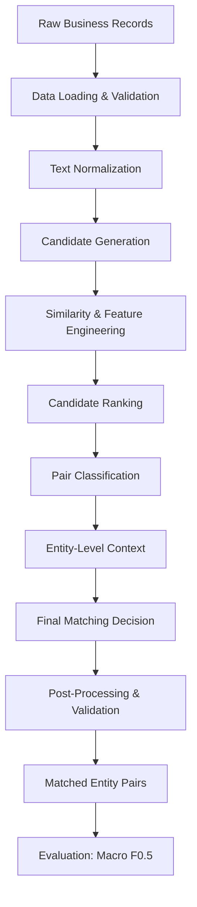

# Amazon ML Challenge — Business Entity Resolution

## 1. Overview

Business entity resolution identifies records that refer to the same real-world business. This Amazon ML Challenge project links large, noisy collections of business records across multiple sources. Records contain fields such as entity ID, business name, business address, and country.

Multiple records can describe the same underlying business despite differences in spelling, formatting, abbreviations, language, or address text. Missing fields reduce the available evidence. Conversely, distinct businesses can have similar names or share an address. Traditional exact matching misses genuine matches when text differs, while name similarity alone can incorrectly merge unrelated businesses.

The system attempts to recover genuine cross-source links while recognizing businesses with no matching record. It combines imperfect evidence at scale and makes precision-oriented decisions. A false match joins two distinct business identities; a missed match leaves a genuine relationship unresolved. The challenge's macro F0.5 metric gives greater weight to precision than recall.

**Portfolio scope:** This repository is an intentionally sanitized edition of Team Agastaya's project. The architecture below describes the complete system conceptually. The public code contains selected reusable utilities and tests. Production candidate generation, specialized features, model settings, second-stage evidence construction, decision policies, and orchestration are withheld.

## 2. Problem Statement

**Input:** Noisy records from three sources. Source 1 is the deduplicated reference source; records from Source 2 and Source 3 must be linked to the corresponding reference business when a match exists. Record IDs identify source records, but do not establish that records from different sources describe the same business.

**Desired output:** Matched entity pairs expressed using original record identifiers, with no forced link when sufficient matching evidence is absent.

```text
Multiple noisy records
        ↓
Identify records belonging to the same real-world entity
        ↓
Generate matched entity pairs
        ↓
Evaluate using macro F0.5
```

The task includes entities with no matching records, incomplete business details, multilingual text, and a test country absent from training. These conditions require generalization beyond exact string agreement and careful handling of ambiguous evidence.

False positives are particularly costly because a plausible-looking link can assign information from one business to another. Precision therefore matters both when evaluating classifiers and when accepting final matches. Macro F0.5 is computed per reference entity and averaged across entities, including singletons. Handling unmatched businesses is part of the task. Exact production decision thresholds are withheld.

## 3. System Architecture

The system progressively reduces uncertainty: validate records, make text comparable, reduce the search space, measure pair evidence, learn compatibility, consider broader context, and produce valid matches.



The diagram shows conceptual responsibilities, not a runnable public pipeline or a one-to-one mapping to production modules. Candidate ranking denotes prioritizing plausible alternatives; a production candidate ranker is not supplied publicly. Entity-level context represents additional evidence considered in the project's second learning stage, whose implementation is withheld.

### Data loading and validation

Structured ingestion establishes consistent fields, handles missing values, and maintains mappings between internal row indices and original record IDs. Explicit TSV schemas and ID mappings are retained in the public utilities. This stage matters because an incorrect mapping can produce an invalid link even when a model's pair assessment is correct.

### Text normalization

Names and addresses are converted into more comparable representations so incidental text variation has less influence on matching. Normalization must also preserve evidence that distinguishes businesses. Public utilities demonstrate basic normalization and parallel text processing. Specialized production transformations are withheld.

### Candidate generation

Candidate generation reduces the search space to plausible pairs before more expensive processing. An exhaustive comparison of every reference record against every other record is impractical at this scale.

This stage creates a fundamental tradeoff: smaller candidate sets reduce computation and memory, but a true pair excluded here cannot be recovered by a downstream classifier. The production blocking recipe and candidate-selection implementation are withheld.

### Similarity and feature engineering

Candidate pairs are represented using numerical evidence about agreement and disagreement in business details. Comparing both names and addresses helps distinguish a genuine identity match from superficial text resemblance, although missing or ambiguous fields can weaken that evidence.

Public utilities retain ordinary name/address string similarities. The exact production feature schema and specialized feature construction are withheld. The architecture describes the purpose of these signals without enumerating a production feature vector.

### Candidate ranking

Ranking prioritizes plausible alternatives using available matching evidence. Relative plausibility helps organize cases in which several records resemble the same reference business.

This is a conceptual responsibility in the diagram. The public edition does not contain a production ranker, and the production implementation and its relationship to other scoring stages are withheld.

### Pair classification

Gradient-boosted classification combines pair evidence to assess whether two records describe the same business. Learning from labeled examples allows multiple imperfect signals to contribute jointly instead of requiring exact equality in each field.

LightGBM provides the model technology. Public training and prediction wrappers are generic: callers supply parameters and training rounds. Tuned hyperparameters, production sampling policies, and complete training orchestration are withheld.

### Entity-level context

The full project included a second learning stage that incorporated additional evidence beyond the isolated pair. This architectural layer addresses ambiguity that pair similarity alone may leave unresolved when alternative matches exist.

Production evidence construction, the second-stage feature representation, and its implementation are withheld. This stage is documented to explain the system's scope, without providing a recipe to reconstruct it.

### Final matching decision

Model evidence is converted into accepted links or unresolved cases. A classifier score alone is not the final deliverable: the system must decide whether the evidence is sufficient to link business identities.

Decision processing emphasizes precision and avoids forcing a match for every record. Exact thresholds and production acceptance/rejection policies are withheld.

### Post-processing and validation

Final consistency handling and output checks ensure that delivered pairs use valid identifiers and satisfy the expected format. The full production post-processing rules are withheld.

Public output helpers serialize supplied pairs; they do not decide production matches. The public `postprocess` directory contains generic utilities rather than a production rule runner.

### Evaluation and error analysis

Macro F0.5 measures matching quality per reference entity, including entities without matches. Its emphasis on precision aligns evaluation with the cost of false merges.

The full project's development methodology included entity-based out-of-fold classifier evaluation and error analysis. This describes evaluation on held-out entities; it does not establish that every upstream learned component underwent independent nested validation. Public tests cover metric behavior on fabricated records rather than benchmark the withheld system.

### Engineering at scale

The project report describes approximately **1.73 million reference entities** and **9.97 million other records** in the test set. Candidate reduction was therefore a central architectural requirement.

Engineering work addressed candidate growth, intermediate memory use, chunked processing, and parallel text processing. Preserving record identity through these transformations was necessary for traceable outputs. Missing addresses, ambiguous names, multilingual variation, and a country absent from training also required attention to generalization and precision/recall tradeoffs. Production-specific findings and tuned remedies are withheld.

## 4. Technologies and Public Components

| Technology | Role |
|---|---|
| Python | Data-processing utilities, model interfaces, evaluation, and output handling. |
| Polars | Structured tabular processing and TSV ingestion. |
| NumPy | Numerical arrays and computations. |
| RapidFuzz | Standard string-similarity calculations for noisy text. |
| Unidecode | Text transliteration supporting basic normalization. |
| LightGBM | Gradient-boosted classification through generic training and prediction wrappers. |
| pytest | Utility verification with small fabricated records. |

The retained code is in [`code/business_entity_resolution/src`](code/business_entity_resolution/src):

| Public component | Retained responsibility |
|---|---|
| `data.py` | Data loading and record-ID mapping. |
| `normalize.py` | Basic text normalization and normalized columns. |
| `features.py` | Ordinary string-similarity features. |
| `models.py` | Generic training and prediction interfaces. |
| `matching.py` | Macro F0.5 matching evaluation. |
| `compare_outputs.py` | Comparison of supplied matching outputs. |
| `postprocess/` | Generic record, text, pair, and geographic helpers. |

Public normalization and features are intentionally reduced. `normalize_name` preserves its tuple return shape with an empty second field because production legal-form extraction is withheld. `add_normalized_columns` retains basic core-name, address, and number columns; production phonetic and legal columns are absent. `match_features` retains standard string similarities. These utilities demonstrate selected components without supplying a replacement production solution.

## 5. Results and Attribution

| Result | Interpretation |
|---|---|
| Historical FinalV2 public leaderboard macro F0.5: **0.987026** | Reported team competition result; not measured by this public edition. |
| Overall rank: **290 / 90,000+ participants** | Reported competition placement. |
| **AIR 7; selected among the top 10 women-only teams** | Reported team recognition. |
| Private rebuilt pipeline out-of-fold macro F0.5: **0.9792** | Reported development result from withheld components. |
| Public utility edition | No model benchmark claimed. |
| Proposed ensemble experiment | No achieved score claimed. |

The original leaderboard model's complete run settings were not retained. The private rebuilt pipeline was not identical to the historical submission. These aggregate results describe project history and cannot be regenerated from the public utilities. Production predictions, candidate lists, feature matrices, weights, and experimental probability dumps are not distributed here.

**Team Agastaya:** Kanika, Kiran Sehrawat, and Mahee Agarwal. This README describes team work. Individual ownership of specific components is not asserted because the supplied material does not establish it.

## 6. Run the Public Checks

Use Python 3.12 or newer with the retained dependency pins. From the repository root:

```bash
cd code/business_entity_resolution
python -m venv .venv
```

Activate the environment for your platform, then run:

```bash
python -m pip install -r requirements.txt pytest==8.4.2
python -m pytest
```

Tests use small fabricated records to exercise retained utilities, including similarities, evaluation with singletons, and output formatting. These commands do not train or run the complete architecture described above. Dependency pins are retained from the original project environment.

Previously recorded verification found that all seven utility tests passed on Windows with Python 3.12.4. A separate smoke check verified imports, loading, normalization, similarities, and output round-tripping. Native LightGBM training raised an access violation in that environment with both the original and unchanged public training wrappers; training still needs verification in the intended execution environment. These are prior verification results, not new test or training results from this README update.

## 7. Data and Portfolio Scope

Public challenge data and training labels are retained in the cleaned local `dataset.zip`. macOS metadata was removed; challenge data bytes and the archive validator's executable logic were preserved, while validator comments/docstrings were removed. The archive is excluded from ordinary Git tracking because of its size. Obtain the public challenge data from its original distribution or a separately hosted copy when working from a clone without the archive.

[`PS.pdf`](PS.pdf) describes the task and evaluation. [`Documentation_template.md`](Documentation_template.md) provides the portfolio case study and additional project lineage.

This edition makes architecture and engineering intent visible while withholding reproduction-sensitive details: the production blocking recipe, exact feature schema, tuned hyperparameters, exact decision thresholds, post-processing rules, second-stage evidence construction, and orchestration. It contains selected runnable components and documented project evidence, with no production training or submission command.
